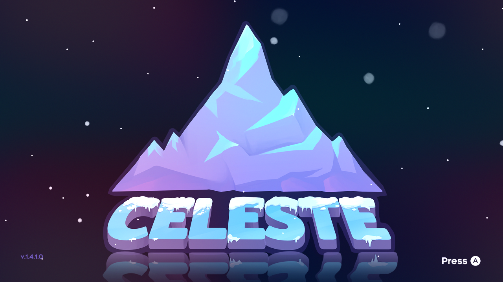
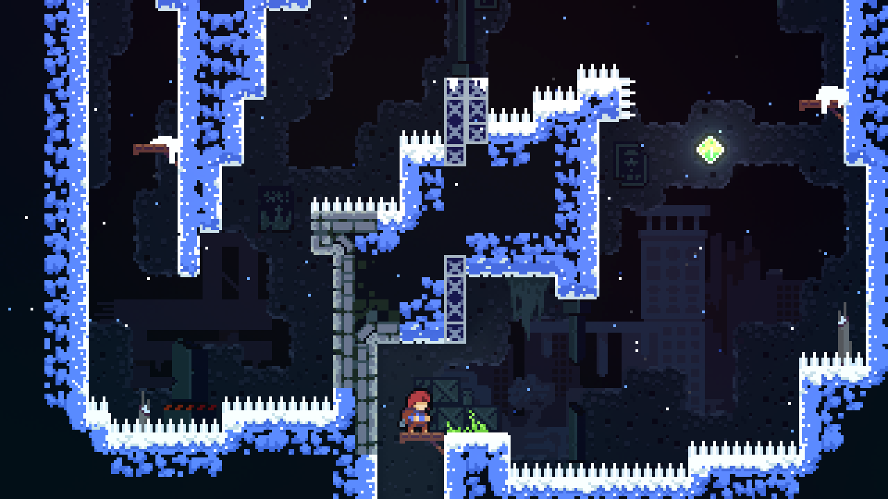
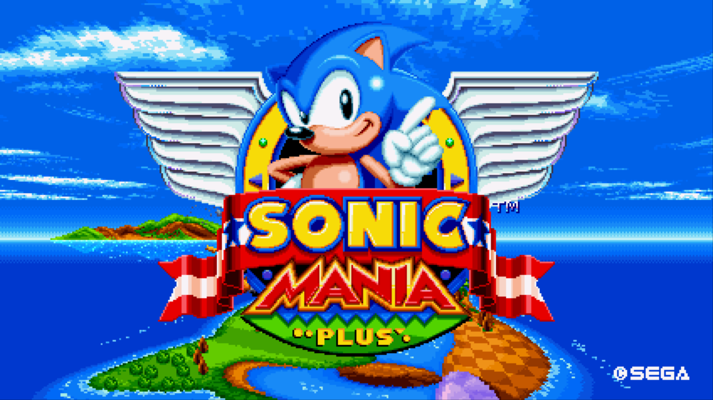
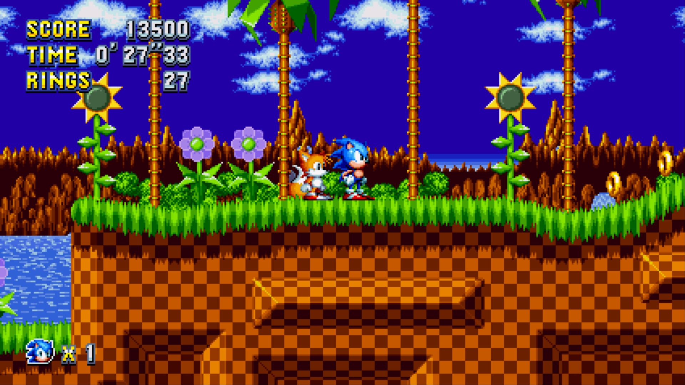
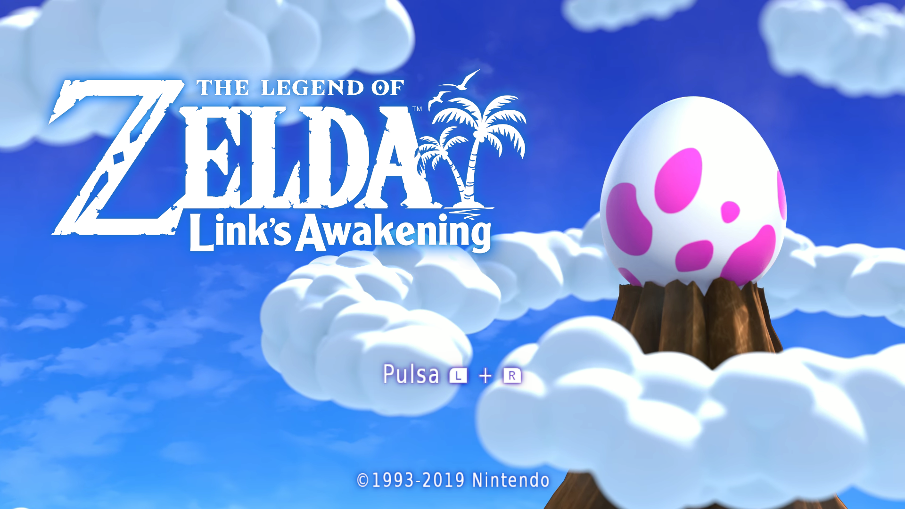
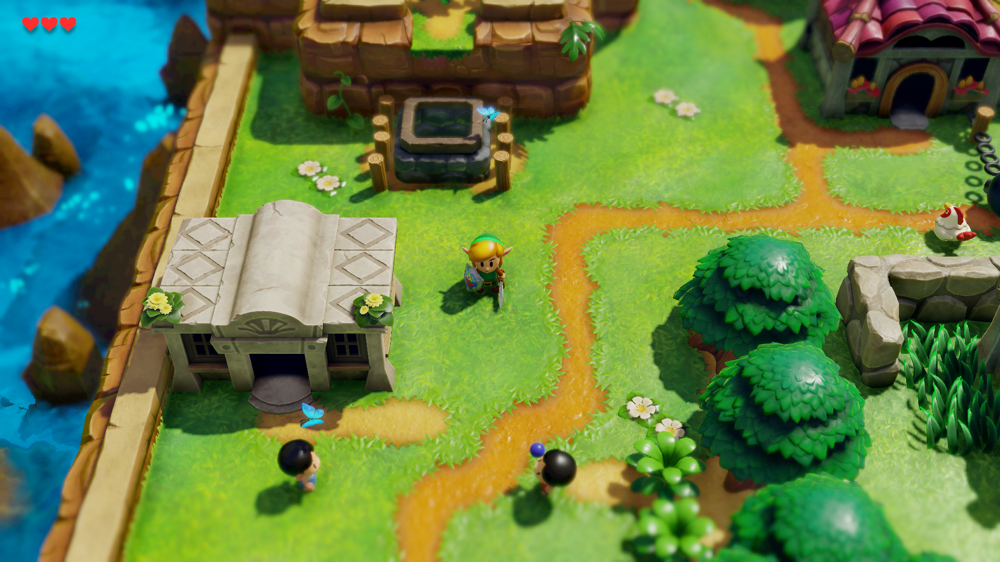

# Nixe

This is an educational and experimental project written in Rust. Its long-term goal is to research and build
functional emulators for Nintendo Switch and Nintendo Switch 2 while sharing well-defined components between
both platforms whenever technically appropriate.

## Goals

- Study modern console emulation and low-level systems programming.
- Build a functional Nintendo Switch emulator incrementally.
- Prepare an extensible foundation for Nintendo Switch 2 research and emulation.
- Reuse CPU, memory, graphics, tooling, and other infrastructure when the underlying behavior is genuinely
  shared.
- Favor testable, documented, and maintainable Rust code.

## Project Status

Nixe is in an early stage of development, but it can already run a range of homebrew applications and
commercial games; some run at native speed, depending on the title and host hardware. It supports homebrew
NRO files and commercial NSP and XCI packages, including the compressed NSZ and XCZ formats. Gamepad input is
available through the emulated HID services.

### Screenshots

<table>
  <tr>
    <td></td>
    <td></td>
  </tr>
  <tr>
    <td></td>
    <td></td>
  </tr>
  <tr>
    <td></td>
    <td></td>
  </tr>
</table>

## JIT compiler

Nixe translates guest AArch64 with [Dynarmic](https://github.com/lioncash/dynarmic).
The original repository is vendored in `vendor/dynarmic`, pinned to commit
`a41c380246d3d9f9874f0f792d234dc0cc17c180`, including its bundled dependencies
and licenses. Cargo builds its A64 frontend, host backend and the C++ bridge
automatically.

Each virtual CPU owns a native code cache, block links, register allocator and
return prediction. The process shares memory and the exclusive monitor. Fastmem
uses nixe's direct arena and signal capture; memory ownership, invalidation,
scheduler interrupts, SVCs and architectural state remain connected to the
runtime. Unsupported instructions stop explicitly.

Building requires a C++20 compiler, CMake and Boost headers, in addition to the
Rust toolchain and graphics/audio dependencies. The NVDEC VP9 decoder links
FFmpeg libraries through `pkg-config`. On Debian/Ubuntu the native build packages
are `build-essential cmake libboost-dev pkg-config libavcodec-dev libavutil-dev`.
Dynarmic dependencies are built from the vendored tree; no CMake download step is required.
Upstream adaptations are listed in [UPSTREAM.txt](vendor/dynarmic/UPSTREAM.txt).

## Running

See [host requirements](docs/host-requirements.md) for required CPU and memory
capabilities. `--offline` is optional once dependencies are cached.

On Linux, `./scripts/build-vulkan-loader.sh` builds a pinned local Vulkan loader
under `dev-tools/vulkan-loader/`. Cargo run/test commands, including `cargo cli`,
use that copy when present; otherwise they use the system loader. See the
[local loader build instructions](crates/gpu-vulkan/README.md#local-linux-loader)
for dependencies and direct executable usage.

The default configuration is in [`nixe.toml`](nixe.toml). Window size and
position are remembered in a versioned binary `nixe.cfg` beside the selected
`nixe.toml`; it is managed by Nixe.

List available titles:

```bash
cargo cli list
```

Run a title by its ID or name:

```bash
cargo cli run <id | name>
```

Hotkeys:

- <kbd>S</kbd>: save a screenshot as a PNG file (see `nixe.toml` for the screenshots directory)
- <kbd>1</kbd>: resize the window to the frame's native resolution.

## Testing

Run

```
cargo test-all
```

### GPU tests

GPU execution tests require a physical GPU; software rasterizers are excluded.
When no physical GPU is available they print `SKIP:` (visible with `--nocapture`)
and return. The standard Rust harness labels these returns `ok`, so they must
not be counted as hardware validation. Errors after GPU initialization remain
test failures. Opt-in native tests and their additional requirements are described
in [the native Vulkan guide](crates/gpu-vulkan/README.md).

### CPU profiling

Build the profiling binary, then capture a 30-second headless execution:

```bash
cargo build-profile
./scripts/profile.sh <id | name>
```

The script writes `perf.data` in the repository root.

## Contributing

See [CONTRIBUTING.md](CONTRIBUTING.md).

## Legal Notice

This project is intended for lawful education, research, interoperability, and preservation work. It does not
provide or distribute games, firmware, cryptographic keys, copyrighted console files, or leaked confidential
material.

Users and contributors are responsible for complying with the laws applicable in their jurisdictions and for
using only software and data they are legally entitled to use.

Nintendo Switch and Nintendo Switch 2 are trademarks of Nintendo. This project is independent and is not
affiliated with, sponsored by, or endorsed by Nintendo or NVIDIA.

## License

Nixe is licensed under the GNU General Public License version 3 or later. See [LICENSE.txt](LICENSE.txt).
