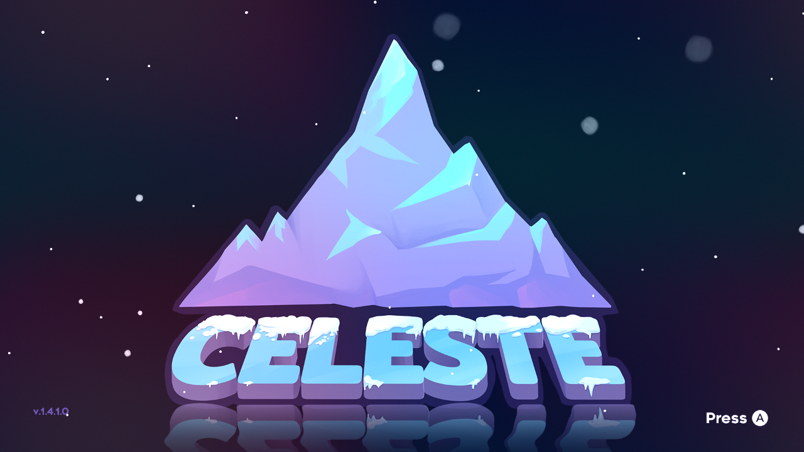
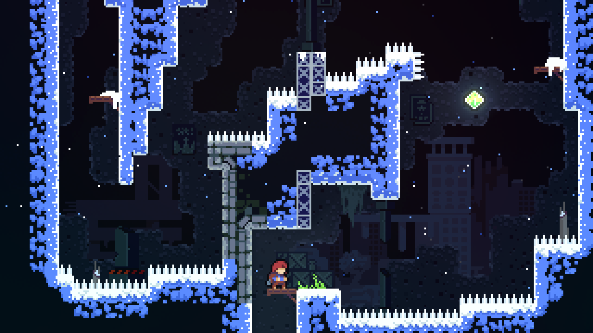
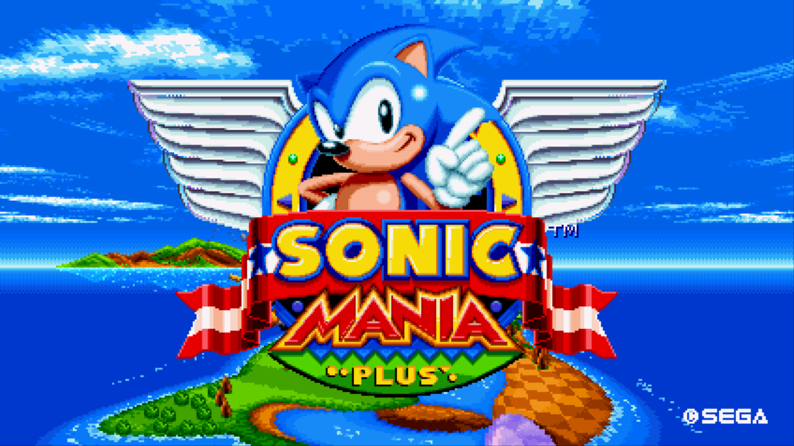
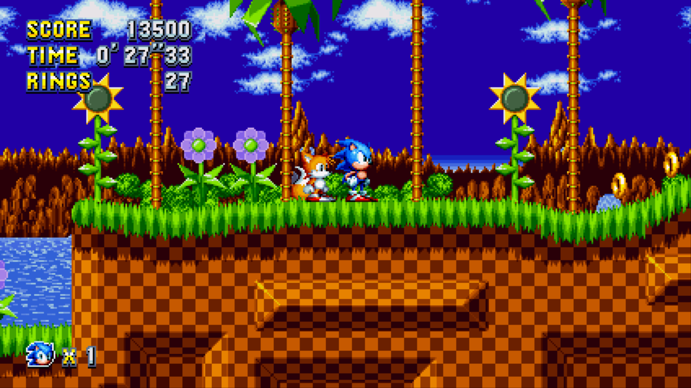
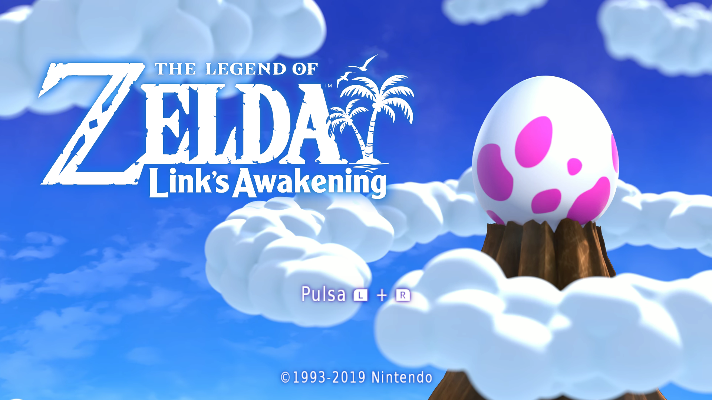
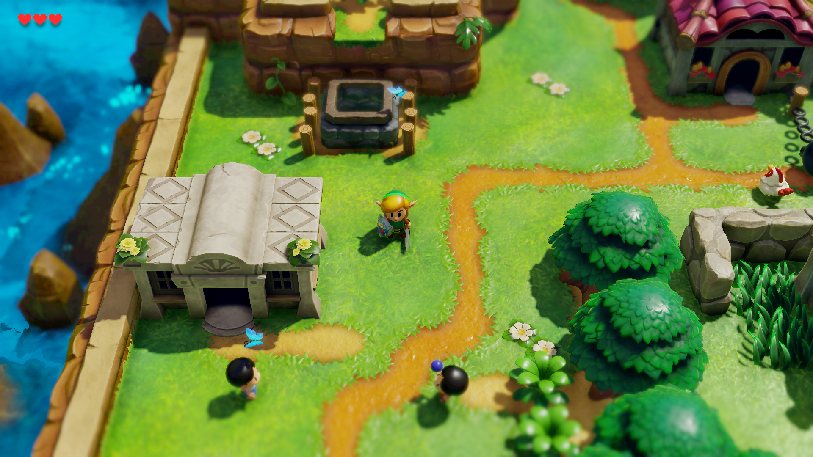
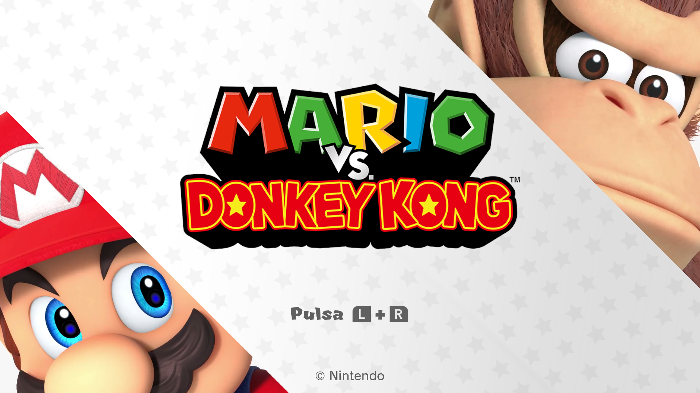
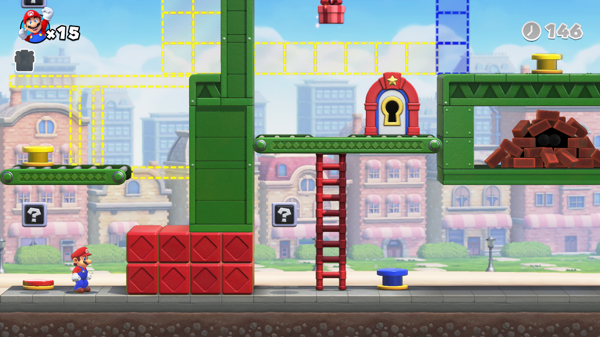

# Nixe

This is an educational and experimental project written in Rust. Its long-term goal is to research and build
functional emulators for Nintendo Switch and Nintendo Switch 2 while sharing well-defined components between
both platforms whenever technically appropriate.

Nixe primarily targets Linux on AMD64 (x86-64). Support for other operating
systems or CPU architectures may be added in the future.

## Goals

- Study modern console emulation and low-level systems programming.
- Build a functional Nintendo Switch emulator incrementally.
- Prepare an extensible foundation for Nintendo Switch 2 research and emulation.
- Reuse CPU, memory, graphics, tooling, and other infrastructure when the underlying behavior is genuinely
  shared.

## Project Status

Nixe is in an early stage of development, but it can already run some Switch homebrew applications and
commercial games; some run at native speed, depending on the title and host hardware. It supports homebrew
NRO files and commercial NSP and XCI packages for Switch, including the compressed NSZ and XCZ formats.
For Switch 2, Nixe supports NUP packages, which can be run without cryptographic keys.
Gamepad input is available through the emulated HID services.

### Screenshots

<table>
  <tr>
    <td></td>
    <td></td>
  </tr>
  <tr>
    <td></td>
    <td></td>
  </tr>
  <tr>
    <td></td>
    <td></td>
  </tr>
  <tr>
    <td></td>
    <td></td>
  </tr>
</table>

### Graphics emulation modes

Set `nvn_hle` under `[gpu]` in [`nixe.toml`](nixe.toml) to choose how Nixe handles
the game's graphics commands. Both modes render through Vulkan.

- **NVN HLE (`nvn_hle = true`).** Nixe intercepts calls to NVIDIA's NVN graphics
  API on Switch and NVN2 on Switch 2, and runs its own Rust implementations.
  Execution stops with a diagnostic if the game calls an unimplemented function.
- **Low-level GPU emulation (`nvn_hle = false`, also the default when omitted).**
  The game runs its original NVIDIA graphics SDK. Nixe intercepts GPU command
  submissions and decodes their pushbuffers to emulate the Maxwell GPU on Switch
  or the Ampere GPU on Switch 2.

## JIT compiler

Nixe uses Dynarmic to compile the game's AArch64 code into native host instructions
as it runs. Each virtual CPU caches the compiled blocks and can link them directly
to one another.

The **memory arena** is a reserved range of virtual addresses in the host process.
Nixe maps guest RAM pages into it at offsets matching their guest addresses. The
reservation itself consumes virtual address space, and mapped pages share the
game's RAM backing.

**Fastmem** lets compiled code read and write those pages directly by adding the
guest address to the arena's base. If a direct access faults, Nixe checks the
mapping and permissions and can complete a valid access through its software
page table.

## Running

See [host requirements](docs/host-requirements.md) for required CPU and memory
capabilities. `--offline` is optional once dependencies are cached.

On Linux, `./scripts/build-vulkan-loader.sh` builds a pinned local Vulkan loader
under `dev-tools/vulkan-loader/`. Cargo run/test commands, including `cargo cli`,
use that copy when present; otherwise they use the system loader. See the
[local loader build instructions](crates/gpu-vulkan/README.md#local-linux-loader)
for dependencies and direct executable usage.

The default configuration is in [`nixe.toml`](nixe.toml). Window size and
position are remembered in a versioned binary `nixe.cfg` beside the selected
`nixe.toml`; it is managed by Nixe.

### Launching games

List available titles:

```bash
cargo cli list
```

Run a title by its ID or name:

```bash
cargo cli run <id | name>
```

Hotkeys:

- Numpad <kbd>+</kbd> / <kbd>-</kbd>: adjust volume in steps of 10; show the volume indicator for two seconds
- <kbd>S</kbd>: save a screenshot as a PNG file (see `nixe.toml` for the screenshots directory)
- <kbd>P</kbd>: pause or resume the emulation
- <kbd>F</kbd>: toggle fullscreen; <kbd>Esc</kbd> also returns to windowed mode
- <kbd>R</kbd>: cycle render resolution through `1×`, `1.5×`, `2×` and `3×` for the current session
- <kbd>A</kbd>: cycle antialiasing through `none`, `FXAA` and `SMAA` for the current session
- <kbd>1</kbd>: resize the window to the current render resolution

## Acknowledgements

Nixe is grateful to the projects and communities whose work has helped make this emulator possible:

- [Switchbrew](https://switchbrew.org/), for its extensive documentation of the Nintendo Switch and its
  system software.
- [Atmosphère](https://github.com/Atmosphere-NX/Atmosphere), for its open-source Switch system software and
  technical references.
- [libnx](https://github.com/switchbrew/libnx), for its Switch homebrew library, which serves as a reference
  for system interfaces and homebrew behavior.
- [Eden](https://git.eden-emu.dev/eden-emu/eden) and yuzu, for the many architectural and optimization ideas
  drawn from their emulators, as well as code used in parts of Nixe.
- [Lichii](https://github.com/zortos293/Lichii), for its graphics architecture and optimization techniques.
- [Dynarmic](https://github.com/lioncash/dynarmic), for the dynamic recompiler used by Nixe's CPU emulation.
- [AsmJit](https://github.com/asmjit/asmjit), for the machine-code assembler used by Nixe's MME JIT compiler.
- [AMD FidelityFX Super Resolution](https://github.com/GPUOpen-Effects/FidelityFX-FSR), for the FSR 1 spatial presentation filter.
- [Phosphor Icons](https://phosphoricons.com/) and [egui-phosphor](https://github.com/amPerl/egui-phosphor), for the host interface icons.

## Contributing

See [CONTRIBUTING.md](CONTRIBUTING.md).

## Legal Notice

This project is intended for lawful education, research, interoperability, and preservation work. It does not
provide or distribute games, firmware, cryptographic keys, copyrighted console files, or leaked confidential
material.

Users and contributors are responsible for complying with the laws applicable in their jurisdictions and for
using only software and data they are legally entitled to use.

Nintendo Switch and Nintendo Switch 2 are trademarks of Nintendo. This project is independent and is not
affiliated with, sponsored by, or endorsed by Nintendo or NVIDIA.

## License

Nixe is licensed under the GNU General Public License version 3 or later. See [LICENSE.txt](LICENSE.txt).
